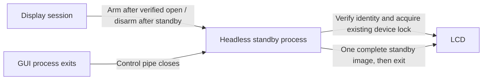

# Standby when the graphical connection disappears

## Failure retained in the record

The first shutdown correction passed native SIGTERM and standby with the LCD, but the owner then repeated a real reboot and still saw the final live frame instead of standby. This is a failed system-shutdown result, not a successful fix. See [the first correction's evidence](shutdown-standby-2026-11-01.json).

A narrowly filtered read of the application's previous-boot journal found the generic Qt warning that Wayland had no outputs and was creating a placeholder screen. No personal journal dump was saved or published. That warning alone is not proof of the complete termination path.

## Reproduction without rebooting the PC

The development instrument creates its own virtual KWin compositor, private session bus, private runtime/configuration directories, and synthetic LCD transport. It terminates only its owned compositor, never the desktop compositor. No real USB device is opened.

On this Arch Linux machine:

| Case | Qt exit | `aboutToQuit` | Python `finally` | Simulated standby sends |
| --- | --- | --- | --- | --- |
| Existing shutdown hooks | 1 | Not reached | Not reached | 0 |
| Independent standby fallback | 1 | Not reached | Not reached | 1 |

The instrument reproduces a route that bypasses the original cleanup. It does not establish that every detail matches the real desktop reboot. Reviewed aggregate results, including the no-USB frozen startup check, are in [the evidence record](display-loss-results.json). Private bus/compositor/application logs are excluded.

## Correction architecture

The CLI starts a small headless standby process **before importing Qt or creating worker threads**. This is Linux-specific fork usage; it is not a fork from an already running Qt/render process. The child preloads its standby artwork/JPEG dependencies and has no graphical connection. It remains usable after a frozen GUI's temporary runtime is removed.

The normal session still performs rendering, telemetry, and live USB output. After it successfully opens the verified LCD transport, it arms the fallback through a private inherited pipe. Only device/encoding settings pass through that pipe; there is no network endpoint and those settings are not logged.



If Qt exits without Python cleanup, pipe EOF triggers one fallback standby image. The helper uses the same transport identity checks and cooperative lock, never steals another sender's lock, and bounds lock-acquisition retries. It does not run a competing animation loop. Normal cleanup disarms it after sending standby, avoiding duplicate images. Preview-only/manual-pause states do not reopen USB after exit, and known report-write failures are disarmed rather than retried.

The original logind, Qt-session, and signal cleanup paths remain. Independent sleep/shutdown pauses remain separate. Simultaneous SIGTERM to an owned process group and closed standard descriptors are covered by regression checks. The helper closes inherited terminal/journal descriptors and handles its own termination window without depending on the GUI event loop.

This adds a short-lived process, not a system service or permanent daemon. Resource profiling must include it; summed RSS can double-count pages shared after fork. No new performance or leak-freedom claim is made.

## Private event trace

GUI mode writes a bounded local trace to `$XDG_STATE_HOME/fx240-linux/shutdown.jsonl`, defaulting to `~/.local/state/fx240-linux/shutdown.jsonl`. The file is restricted to mode 0600, avoids symlinks, and stops appending at approximately 64 KiB. Log failures do not prevent display or cleanup.

Each record has **only** an allowlisted event code and relative elapsed seconds. There are no names, home paths, hostnames, PIDs, machine/boot identifiers, addresses, temperatures, selected device paths, or arbitrary OS error messages. Signal handlers do not write logs; event dispatch records them on the normal execution path. Keep this local file outside the repository. It lets the next real shutdown distinguish GUI cleanup from fallback completion without exporting personal journals.

## Repeat the optional isolated test

Install the normal desktop development dependencies and have `kwin_wayland` and `dbus-run-session` available. These are **optional test dependencies**, not runtime requirements of Studio. The command creates a private bus automatically:

```bash
.venv/bin/python tools/reproduce_wayland_loss.py --output-dir /tmp/fx240-wayland-test
.venv/bin/python tools/reproduce_wayland_loss.py --output-dir /tmp/fx240-wayland-test --guard
```

Only reviewed `result.json` summaries are publication candidates. Native private logs can contain paths or library/environment details and must not be uploaded automatically. The headless/virtual flags are required: never substitute a command that controls the user's active compositor.

## Physical LCD and frozen executable result

The frozen executable was then run on an owned virtual screen with the real LCD. The owner confirmed updating readings and animation. When only that test compositor was closed, the GUI exited with code 1 without reaching GUI cleanup or receiving logind shutdown preparation. The separate helper completed the standby write, and the owner confirmed that the physical LCD showed the recreated standby image. No desktop restart or personal image/video capture was involved.

The tested binary was installed at the existing autostart path. The owner then repeated actual desktop reboot with this binary and again observed the last live telemetry image instead of standby. This is a **failed OS reboot result**, despite the successful isolated physical display-loss test. The private trace recorded startup, fallback arming and `logind-shutdown`, but no worker release or fallback completion before the next startup. It does not establish whether the processes were blocked or terminated.

SIGKILL of the entire process group, immediate device power loss, an unavailable USB interface, another sender holding the lock, or a blocked kernel transfer can still prevent standby. The logind delay window remains bounded by the system. This is a fallback for observed graphical-process loss, not a guarantee against every power or process failure. Other distributions remain untested.

## Follow-up: drain inside shutdown preparation

The previous callback requested a USB pause and returned to Qt, relying on subsequent worker scheduling and timer checks. The follow-up waits for `output_released` inside shutdown preparation, for at most two seconds, before saving preferences. Waiting releases the Python GIL so the existing worker can finish its frame and send standby. Only that worker owns the USB transport; the callback does not send competing reports. Shutdown cancellation still resumes the session, while manually paused output remains paused.

New allowlisted trace codes distinguish drain start, output release and timeout. Output release means the worker relinquished the transport; it is not independent optical evidence that standby appeared. A timeout retains the inhibitor until the existing timer observes release or the system's own bounded delay expires. Tests cover an in-flight frame that finishes without processing Qt events and a timeout that must not report release. This removes an asynchronous cleanup window; it does **not** prove the cause of the failed reboot or establish that the new build fixes it. The full suite passed 113 tests, including seven shutdown regressions. The new frozen executable passed a no-USB self-test. See [candidate evidence](shutdown-drain-results.json). Physical and actual OS validation remain pending.
